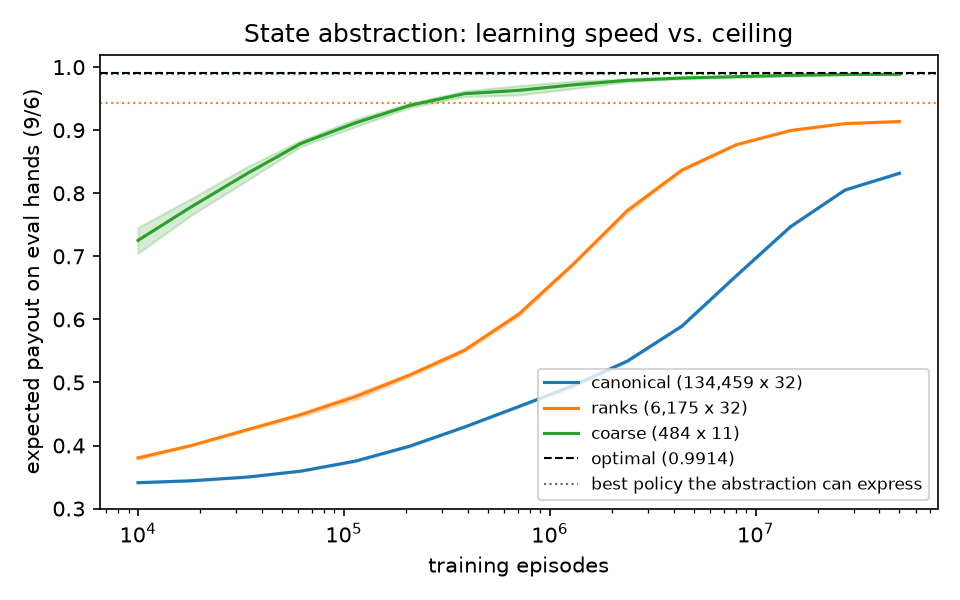
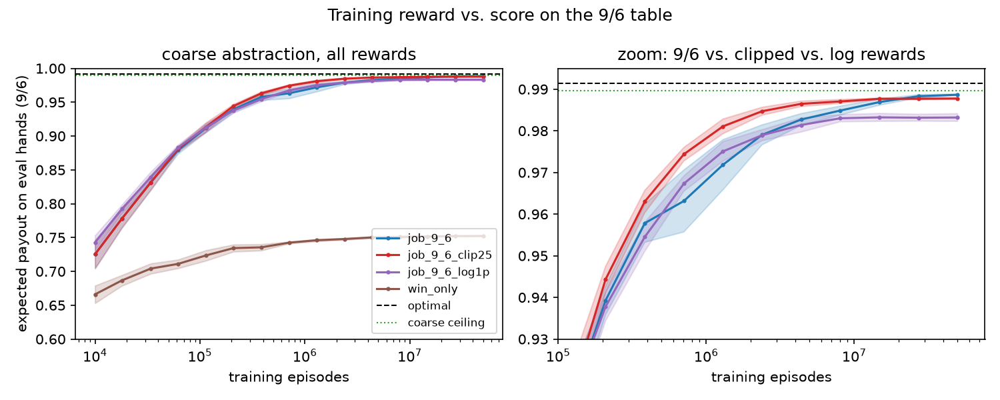

### State abstraction and reward design

**Exact action values.** For every comparison in this section we need the true value of a policy, not a Monte Carlo estimate. For a set X of cards let S[X] be the total payout of all 5-card hands that contain X; one pass over the 2,598,960 hands fills S for every set of 0 to 5 cards. A hand that keeps H and discards D can reach C(47, |D|) final hands, and by inclusion–exclusion over the discards their total payout is Σ_{T⊆D} (−1)^{|T|} S[H ∪ T]. This gives the exact Q*(s, a) for all 134,459 × 32 state–action pairs in about 4 seconds for any paytable (`exact_values.py`). It agrees with Task 1's draw-by-draw enumeration to machine precision, and the optimal 9/6 policy returns **0.995439** per unit bet with standard deviation 4.417, the published values for full-pay Jacks or Better (8/5: 0.972984, also as published). Because a single draw ends the episode, a policy's expected payout is just the average of Q* over the hands it plays, so all scores below are exact; the only uncertainty left is which hands were sampled. The eval split's optimal score is 0.9914 (±0.008, 95% CI over hands); it sits a little below the uniform-deal value, well within sampling error, partly because the split happens to contain no straight or royal flushes.

**State abstractions.** Each abstraction maps a canonical state to an abstract state and each abstract action to a mask on the canonical hand (`abstraction.py`), so the agent's table has shape (states × actions) and the same learner runs on all three:

| Abstraction | State | Actions | Table entries | Best expressible policy (uniform deal) | % of optimal |
|---|---|---|---:|---:|---:|
| canonical | the full canonical hand (Task 1) | 32 masks | 4,302,688 | 0.9954 | 100.0 |
| ranks | sorted ranks only; suits dropped | 32 masks | 197,600 | 0.9477 | 95.2 |
| coarse | (made hand, flush-draw size, straight-draw type, straight-flush-draw size, royal-draw size, number of J+ ranks) | 11 hold rules | 5,324 | 0.9937 | 99.8 |

The "best expressible policy" column is the highest return any table over that abstraction can reach. For each abstract state we average the exact Q* of every action over the hands the state contains (weighted by their deal probability) and take the best action. It is an upper bound for learning, not a learned result.

The coarse state cannot use positional masks: two hands with the same feature tuple hold their flush cards in different positions, so "keep positions 0, 2, 3" means different things in each. Its actions are therefore *hold rules* that are turned into a concrete mask for each hand: draw five, stand, keep pairs, keep the flush draw, keep the straight draw, keep the straight-flush draw, keep the royal draw, keep all J+ cards, keep the suited J+ cards, and keep the highest one or two J+ cards. With 484 states and 11 rules the table is 800× smaller than the canonical one but loses only 0.0017 per hand. Dropping suits (ranks) loses 0.048, mostly from hands where the right play is a flush or royal draw.

**Learning under each abstraction.** To see how fast each table can be learned, we train the same tabular Q-learner on all three abstractions: step size α = 1/N(s, a) (a running mean, since each episode ends after the draw), ε-greedy exploration decayed linearly from 1.0 to 0.05 over the first half of training, start hands drawn from the train split, and 50M episodes per run over 5 seeds (`task4_experiments.py`). Every checkpoint's greedy policy is scored exactly on the 50,000 eval hands. This learner is fixed so that only the abstraction changes; the step-size and exploration sweeps are part of Task 2.

| Abstraction | Eval score after 200k episodes | after 2.4M | after 50M (mean ± sd, 5 seeds) | Best expressible (eval) |
|---|---:|---:|---:|---:|
| canonical | 0.399 | 0.534 | 0.8317 ± 0.0010 | 0.9914 |
| ranks | 0.512 | 0.773 | 0.9137 ± 0.0003 | 0.9432 |
| coarse | 0.939 | 0.979 | 0.9887 ± 0.0002 | 0.9897 |

The coarse table learns fastest and ends highest: about 0.01 below its ceiling after 2.4M episodes and within 0.001 by 50M. The canonical table can express the optimal policy, but after 50M episodes, about 370 per state and 12 per state–action pair (10% of pairs are still unvisited), it reaches only 0.832 and is still improving. With a 1/N step size, an entry tried a handful of times is a noisy mean, and one lucky draw makes a bad hold look best. The ranks table sits between them: it learns faster than canonical but cannot get past 0.943 because it never sees a flush draw. Over the whole budget, the 800× smaller coarse table is the best choice by a wide margin, and canonical would need far more data (or the better exploration that Task 2 studies) to use its extra 0.0017 of headroom.

**Reward design.** Each paytable below is the reward for a full training run; we compute its optimal policy exactly and then score that policy on the main 9/6 table.

| Reward | Kind | Optimal return on its own table | Return of its optimal policy on 9/6 | Loss vs. 9/6 optimal | Hands where the hold changes | Std. dev. on 9/6 | P(paying hand) |
|---|---|---:|---:|---:|---:|---:|---:|
| 9/6 Jacks or Better (main) | game | 0.9954 | 0.9954 | — | — | 4.42 | 45.5% |
| 8/5 Jacks or Better | game | 0.9730 | 0.9954 | <0.0001 | 0.4% | 4.43 | 45.5% |
| 9/6, royal = 250 | game | 0.9837 | 0.9944 | 0.0010 | 3.4% | 4.02 | 45.4% |
| win-only (1 for any paying hand) | game | 0.4783 | 0.71–0.88† | 0.11–0.29† | 35.7%† | 3.59† | 47.8% |
| 9/6, log(1 + payout) | training reward | 0.4711 | 0.9863 | 0.0092 | 5.7% | 3.57 | 46.1% |
| 9/6, clipped at 25 | training reward | 0.9773 | 0.9919 | 0.0035 | 4.7% | 3.70 | 45.4% |

† Under win-only, many hands have several holds with the same chance of being paid (2.3 on average), and which one is played changes the 9/6 score. The range runs from the worst to the best tie-break; the other † columns use the lowest mask.

The full house and flush pays move very little: the 8/5 table changes the best hold in only 0.4% of hands (for example, it prefers J-K offsuit over a three-card straight flush with a jack), and those changes cost almost nothing on 9/6. The size of the royal payout matters more. At 250 the agent stops chasing three-card royals and keeps a low pair instead (e.g. T♠T♦ instead of T♠J♠A♠), changing 3.4% of holds. The win-only reward shows what happens when the reward ignores how big a hand is: it raises the chance of being paid from 45.5% to 47.8% but gives up 0.11–0.29 per hand on 9/6, because it keeps a high pair over a four-card royal (losing about 18 units on those hands).

The two training rewards keep the order of the hands and only shrink the jackpot, which lowers the variance of the learning signal. The cost is bias: clipping at 25 means the agent stops breaking a made straight to draw to a royal (losing about 15.6 units on such hands), and log1p shrinks the royal so much that the agent prefers a high pair to a four-card royal. On the exact optimal policies this costs 0.0035 (clip) and 0.0092 (log1p) per hand.

**Learning with each reward.** We repeated the training runs with each training reward and scored every policy on 9/6. Runs with the same seed share their random numbers, so the curves are paired comparisons.

| Training reward (coarse) | Eval score after 700k episodes (mean ± sd) | after 2.4M | after 50M |
|---|---:|---:|---:|
| 9/6 (main) | 0.9631 ± 0.0074 | 0.9790 ± 0.0024 | 0.9887 ± 0.0002 |
| clipped at 25 | 0.9744 ± 0.0016 | 0.9847 ± 0.0009 | 0.9877 ± 0.0002 |
| log(1 + payout) | 0.9673 ± 0.0018 | 0.9790 ± 0.0013 | 0.9832 ± 0.0009 |
| win-only | 0.7420 | 0.7480 | 0.7523 ± 0.0002 |

On the coarse table this is the bias–variance trade-off we expected. Clipping at 25 removes the rare 50- and 800-unit payouts from the learning signal, so early estimates are steadier: it is ahead by about 0.011 at 700k episodes with a quarter of the seed-to-seed spread. Its bias then caps it. The raw 9/6 reward overtakes it between 15M and 27M episodes and finishes 0.001 higher. log1p cuts variance too, but its bias is larger (it undervalues every big hand, not just the jackpots), so it is never clearly ahead and plateaus 0.0055 lower. The win-only reward learns its own objective quickly and ends at 0.752 on 9/6, the score of the best coarse policy for win-only (0.7527), at the low end of the tie-break range above. On the canonical table the reward barely matters at this budget (50M episodes: 9/6 0.8317, clip 0.8318, log1p 0.8290, win-only 0.7532): with about 12 samples per entry, the noise from ordinary payouts swamps the effect of the jackpot.

**Takeaways for the final agent.** (1) Use the coarse abstraction when episodes are limited; it gets 99.7% of the optimal eval score with 5,324 table entries. (2) Score every variant on the 9/6 table with the exact evaluator; reward transforms are training tools, not objectives. (3) A clipped reward is a reasonable way to speed up early learning, but train on the true payouts for the final policy.
