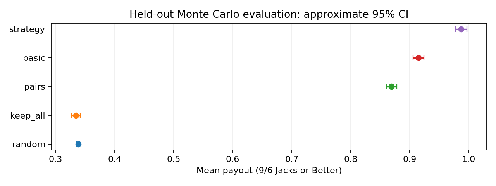
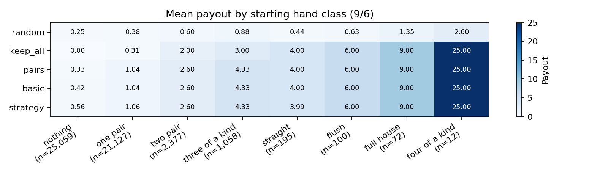
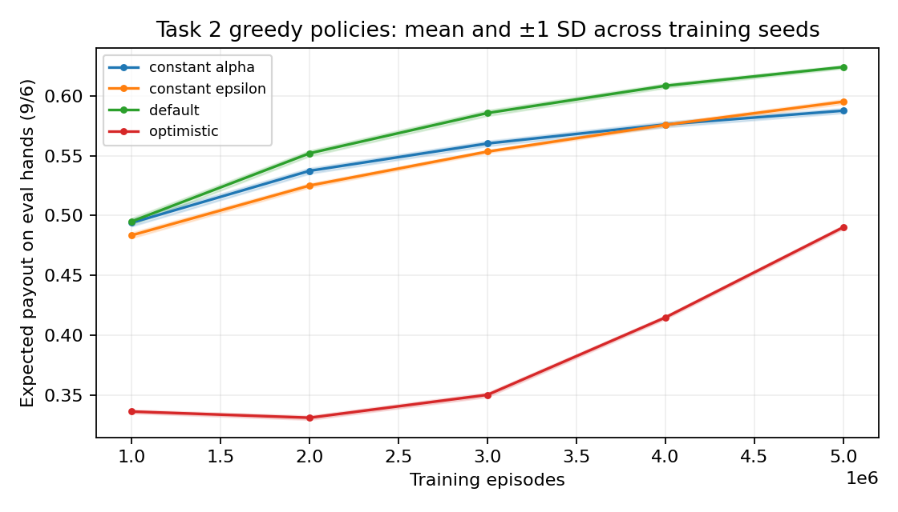
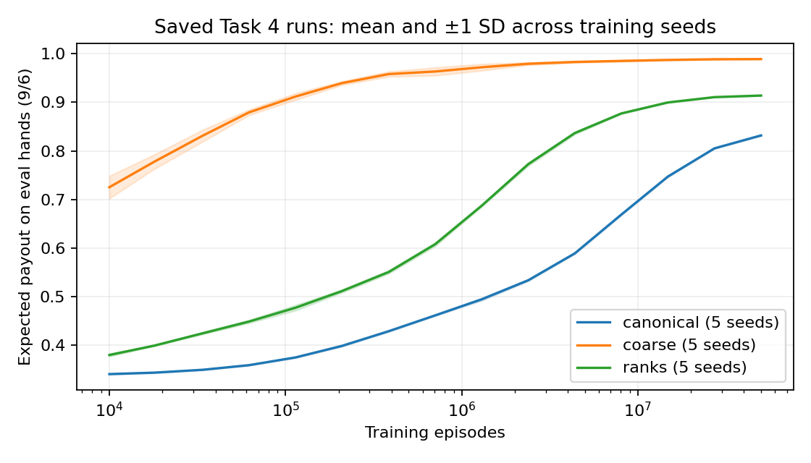

# Evaluation and Results (Task 5)

## Evaluation setup

We evaluated the baseline policies on the same 50,000 held-out starting hands using the
9/6 Jacks-or-Better paytable. We simulated 10 draws per hand for each of five
evaluation seeds, giving 2.5 million outcomes per policy. The runner uses the
existing baseline policies and poker simulator. It does not train the policies.

We averaged the results for each starting hand, then calculated the mean payout
and an approximate 95% interval using mean ± 1.96 standard errors. This avoids
counting repeated draws as extra independent starting hands. We also measured
variation across evaluation seeds and runtime, including decisions, draws, and
scoring. Initial scoring-table setup and checkpoint loading are excluded.

## Policy comparison

The following values are rounded from the generated `policy_comparison.csv`.
The table and figures use the saved code outputs in `results/task5`.

| Policy | Mean payout | Approx. 95% interval | SD across evaluation seeds | Seconds per seed |
|---|---:|---:|---:|---:|
| Random | 0.3385 | [0.3361, 0.3409] | 0.0031 | 1.77 |
| Keep all | 0.3342 | [0.3264, 0.3421] | 0.0000 | 0.93 |
| Pairs | 0.8692 | [0.8605, 0.8779] | 0.0033 | 12.76 |
| Basic | 0.9148 | [0.9058, 0.9238] | 0.0044 | 16.36 |
| Strategy | 0.9874 | [0.9778, 0.9969] | 0.0076 | 25.46 |

The strategy policy has the highest measured payout. Keeping pairs improves
over random and keep-all, and adding the basic draw rules improves the mean
further. Strategy also takes the longest to evaluate, mainly from choosing
actions. These timings are specific to this machine.

Random and keep-all have close means and overlapping intervals, so this result
does not show a clear winner between them. Keep-all has zero variation across
evaluation seeds because it never draws replacement cards. Its interval is
still nonzero because different starting hands have different payouts.

## Results by starting hand

The class results show improvements on high-card and one-pair starting hands,
which are the most common classes. The heuristics have similar scores for many
made hands because they keep those cards. All policies use the same paytable.

There are only 12 four-of-a-kind starting hands and no straight flush or royal
flush starting hands in this split. Missing classes are recorded as unavailable,
not zero payout. We should be careful about conclusions for these rare classes.

## Task 2 learned policies

We trained the four settings listed in Task 2's report for five million episodes
each, using seeds 0–4. We evaluated the saved policies without exploration: each
hand uses the action with the largest Q-value. We reused Task 4's exact evaluator
on the same 50,000 evaluation hands. These scores average over all possible
replacement draws, rather than estimating the payout with Monte Carlo samples.
This differs from the proposal's Monte Carlo scoring and is reported separately.

The values below come from `task2_final_comparison.csv`. The standard deviation
is across the five training seeds, not an interval over replacement draws.

| Configuration | Mean expected payout | Training-seed SD | Visited state/action pairs |
|---|---:|---:|---:|
| Default | 0.6242 | 0.0013 | 36.8% |
| Constant learning rate | 0.5877 | 0.0020 | 36.8% |
| Constant exploration | 0.5952 | 0.0019 | 29.8% |
| Optimistic initialization | 0.4902 | 0.0014 | 80.9% |

Default has the highest final mean among these settings. All four improve from
their first measured checkpoint, but remain below the pairs, basic, and strategy
baseline means. Five million episodes are not enough to estimate every entry
well: the default run visits only about 37% of the state/action pairs. Optimistic
initialization visits more pairs, but that does not give it the best policy at
this budget. We should not claim that these curves have converged.

## Task 4 learning curves and limitations

This figure uses Task 4's existing main-reward results. The lines show means
across five training seeds, and the shading shows ±1 sample standard deviation.
Task 4 computes expected payouts exactly, so this shading measures training
variation rather than random replacement draws.

From the generated `learning_curves.csv`, the final means after 50 million
episodes are 0.8317 for canonical, 0.9137 for ranks, and 0.9887 for coarse.
The coarse model learns fastest and finishes highest in these runs. Its mean
is close to the strategy baseline, but the different scoring methods do not
establish that either is better.

The 95% intervals are a simple hand-level approximation rather than a
stratified-sampling calculation, and rare large payouts can make them less
reliable. Evaluation seeds measure draw noise; training seeds measure variation
between learned policies. The shared eval split is held out from training, but
Task 4 already inspected its scores during development.

Task 4 uses its own batched learner and a larger training budget, so its scores
are not a controlled comparison against the five-million-episode Task 2 runs.
Training rewards include exploration; all learned-policy results here instead
use saved greedy policies without updating their parameters.
